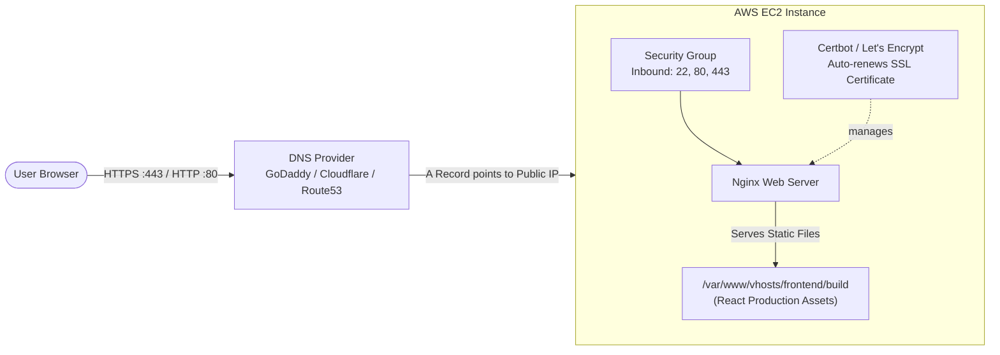

# Deploy ReactJS Application on AWS EC2 with Nginx, Custom Domain & SSL (HTTPS)

A comprehensive, production-ready guide to deploying a ReactJS single-page application (SPA) on an **AWS EC2 Ubuntu Server** using **Nginx** as a high-performance web server, configured with custom domain mapping and free automated **SSL/TLS certificates via Let's Encrypt (Certbot)**.

[](https://github.com/codewithmuh/react-aws-ec2-nginx/releases)
[](https://github.com/codewithmuh/react-aws-ec2-nginx/stargazers)
[](https://github.com/codewithmuh/react-aws-ec2-nginx/network/members)
[](LICENSE)
[](https://youtube.com/@codewithmuh)
[](https://www.linkedin.com/in/muhammadrashid-daha/)

📺 **Full YouTube Video Tutorial:** https://youtu.be/UK_OVKDRArs


---

## 📑 Table of Contents
1. [Architecture Overview](#architecture-overview)
2. [Prerequisites & AWS Security Group Rules](#prerequisites--security-group-rules)
3. [Step 1: Launch an AWS EC2 Ubuntu Server](#step-1-launch-an-aws-ec2-ubuntu-server)
4. [Step 2: Connect to EC2 via SSH](#step-2-connect-to-ec2-via-ssh)
5. [Step 3: Install Node.js, NPM, and Nginx](#step-3-install-nodejs-npm-and-nginx)
6. [Step 4: Clone the React Application](#step-4-clone-the-react-application)
7. [Step 5: Install Dependencies & Build for Production](#step-5-install-dependencies--build-for-production)
8. [Step 6: Configure Nginx as Web Server](#step-6-configure-nginx-as-web-server)
9. [Step 7: Map Custom Domain (DNS A Record)](#step-7-map-custom-domain-dns-a-record)
10. [Step 8: Secure with Free SSL/TLS (Certbot / Let's Encrypt)](#step-8-secure-with-free-ssltls-certbot--lets-encrypt)
11. [Troubleshooting & Common Pitfalls](#troubleshooting--common-pitfalls)
12. [Author & Community](#author)
13. [License](#license)

---

## 🏛️ Architecture Overview



---

## 🛡️ Prerequisites & Security Group Rules

Before beginning, ensure your AWS EC2 Security Group allows the following **Inbound Rules**:

| Type | Protocol | Port Range | Source | Purpose |
| :--- | :--- | :--- | :--- | :--- |
| **SSH** | TCP | `22` | `My IP` (recommended) or `0.0.0.0/0` | Secure shell administration |
| **HTTP** | TCP | `80` | `0.0.0.0/0` | Standard web traffic & ACME challenge |
| **HTTPS**| TCP | `443`| `0.0.0.0/0` | Encrypted web traffic (SSL) |

---

## 🚀 Step-by-Step Deployment Guide

### Step 1: Launch an AWS EC2 Ubuntu Server
1. Log into your [AWS Management Console](https://console.aws.amazon.com/).
2. Navigate to **EC2 Dashboard** → Click **Launch Instance**.
3. Choose **Ubuntu Server 22.04 LTS or 24.04 LTS** (64-bit x86).
4. Instance type: `t2.micro` or `t3.micro` (Eligible for AWS Free Tier).
5. Select or create an SSH Key Pair (`.pem`) and download it.
6. Under Network Settings, attach the Security Group configured with ports `22`, `80`, and `443`.
7. Click **Launch Instance**.

### Step 2: Connect to EC2 via SSH
Open your terminal on macOS / Linux (or PowerShell / Git Bash on Windows):

```bash
chmod 400 /path/to/your-key.pem
ssh -i /path/to/your-key.pem ubuntu@<YOUR-EC2-PUBLIC-IP>
```

### Step 3: Install Node.js, NPM, and Nginx
Update package repositories and install Node.js LTS (v20) and Nginx:

```bash
# Update Ubuntu system
sudo apt-get update -y && sudo apt-get upgrade -y

# Setup Node.js 20.x repository
curl -fsSL https://deb.nodesource.com/setup_20.x | sudo -E bash -

# Install Node.js, NPM, and Nginx
sudo apt-get install -y nodejs npm nginx

# Verify installations
node -v
npm -v
nginx -v
```

### Step 4: Clone the React Application
Navigate to your home directory and clone your code:

```bash
cd ~
git clone https://github.com/codewithmuh/react-aws-ec2-nginx.git
cd react-aws-ec2-nginx
```

*(If cloning a private repository, generate and use a GitHub Personal Access Token).*

### Step 5: Install Dependencies & Build for Production
Install project packages and compile optimized static assets:

```bash
# Install npm dependencies
npm install

# Create production build
npm run build

# Create web root directory and copy build files
sudo mkdir -p /var/www/vhosts/frontend/
sudo cp -R build/ /var/www/vhosts/frontend/
sudo chown -R www-data:www-data /var/www/vhosts/frontend/
```

### Step 6: Configure Nginx as Web Server
1. Remove the default Nginx welcome configuration:
   ```bash
   sudo rm -f /etc/nginx/sites-enabled/default
   ```

2. Create a new virtual host configuration:
   ```bash
   sudo nano /etc/nginx/sites-available/react-app
   ```

3. Paste the following configuration (replace `yourdomain.com` with your domain or `_` if using IP):
   ```nginx
   server {
       listen 80;
       server_name yourdomain.com www.yourdomain.com;

       root /var/www/vhosts/frontend/build;
       index index.html index.htm;

       location / {
           try_files $uri $uri/ /index.html;
       }

       # Cache static assets
       location ~* \.(js|css|png|jpg|jpeg|gif|ico|svg)$ {
           expires 30d;
           add_header Cache-Control "public, no-transform";
       }
   }
   ```

4. Enable the site and test the configuration:
   ```bash
   sudo ln -s /etc/nginx/sites-available/react-app /etc/nginx/sites-enabled/
   sudo nginx -t
   sudo systemctl restart nginx
   ```

### Step 7: Map Custom Domain (DNS A Record)
In your domain registrar (GoDaddy, Namecheap, Cloudflare, AWS Route 53):
1. Add an **A Record**:
   - **Host / Name**: `@`
   - **Value / Points to**: `<Your-EC2-Public-IP>`
   - **TTL**: Auto or 300 seconds
2. Add a **CNAME** or **A Record** for `www` pointing to `@` or `<Your-EC2-Public-IP>`.
3. Wait 2-5 minutes for DNS propagation.

### Step 8: Secure with Free SSL/TLS (Certbot / Let's Encrypt)
Run Certbot to automatically configure HTTPS and redirect HTTP to HTTPS:

```bash
# Install Certbot and the Nginx plugin
sudo apt-get install -y certbot python3-certbot-nginx

# Obtain and install SSL Certificate
sudo certbot --nginx -d yourdomain.com -d www.yourdomain.com

# Verify auto-renewal timer
sudo systemctl status certbot.timer
```

---

## 🔍 Troubleshooting & Common Pitfalls

| Issue | Cause | Solution |
| :--- | :--- | :--- |
| **Site cannot be reached (Timeout)** | AWS Security Group missing port 80/443 | Open port 80 and 443 to `0.0.0.0/0` in EC2 Security Group inbound rules. |
| **404 Not Found on Route Refresh** | Nginx missing `try_files` SPA routing fallback | Ensure `try_files $uri $uri/ /index.html;` is present in your Nginx config. |
| **403 Forbidden** | Incorrect file permissions on build folder | Run `sudo chown -R www-data:www-data /var/www/vhosts/frontend/` and `sudo chmod -R 755 /var/www/vhosts/frontend/`. |
| **Certbot DNS Verification Failed** | Domain DNS has not propagated yet | Verify your domain points to your EC2 public IP using `nslookup yourdomain.com`. |

---

## 👨‍💻 Author

**Muhammad Rashid** — DevOps & Cloud Engineer, AWS Community Builder.  
- 🎥 **YouTube:** [@codewithmuh](https://youtube.com/@codewithmuh)  
- 💼 **LinkedIn:** [Muhammad Rashid](https://www.linkedin.com/in/muhammadrashid-daha/)  
- 🌐 **Website:** [codewithmuh.com](https://codewithmuh.com) · [devopsbymuh.com](https://devopsbymuh.com)

⭐ **If you found this guide helpful, please star the repository!**

---

## 📄 License
This project is open-source under the [MIT License](LICENSE).
